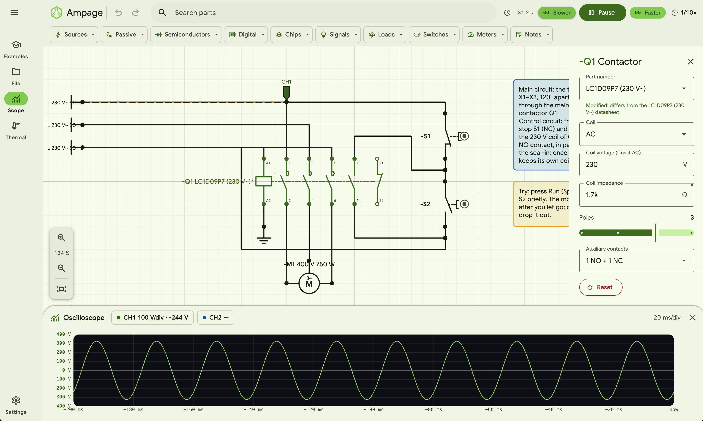

<p align="center">
  
</p>

# Ampage

Circuits that come alive in your browser.

Ampage is a browser technology-based electronics simulator. Drag parts onto a grid,
wire them up and press Run to watch lamps glow, current flow and
overloaded parts burn out. Schematics follow DIN EN 60617 symbols and
EN 81346 reference designations (-R1, -S1, -P1…).



## Features

- **Live simulation**: DC and AC transient analysis (nodal analysis with
  Newton–Raphson for diodes and transistors), from 1/1000× to 1000× speed
- **Realistic behaviour**: capacitors charge, batteries drain, parts heat
  up and fail when overloaded
- **Parts**: batteries, AC generator, +V rails and AC phase, resistors,
  capacitors, inductors, potentiometers, LDR, NTC, transformer, fuse,
  coloured lamps and LEDs, 7-segment display, switches (on/off, changeover)
  and push buttons, relays and AC contactors, DC and AC (1~ and 3~) motors,
  heater, solenoid, fluorescent tube with ballast and starter, buzzer, piezo,
  bell and speaker (audible while running), pilot lamp, stack light,
  bi-colour LED, LED bar graph, dot-matrix display (any size, mono or RGB), diodes, BJTs, MOSFET, logic gates,
  flip-flops, 555 timer, CD4511 decoder, CD4017 counter, LM358 op-amp,
  ULN2003 driver, voltage regulator, DC/AC voltmeter and ammeter, and an
  analog panel meter
- **Editing**: snap-to-grid, right-angle wires, joints, drop a part onto a
  wire to splice it in, copy/cut/paste/duplicate, marquee select
- **Visual feedback**: animated current flow, glowing lights, charge
  gauges, net highlighting and live readouts on hover
- **Files**: save and open circuits as JSON; autosaves in the browser

## Getting started

Requires Node.js 20.19+ or 22.12+.

```sh
npm install
npm run dev      # start the dev server
npm run build    # typecheck and build to dist/
npm run preview  # serve the build
```

## Shortcuts

| Key                    | Action                                                                                     |
| ---------------------- | ------------------------------------------------------------------------------------------ |
| ⌘K                     | Search parts                                                                               |
| Space                  | Run / pause the simulation                                                                 |
| ← / →                  | Slow down / speed up the simulation (10× steps)                                            |
| R                      | Rotate (also while dragging)                                                               |
| Delete / Backspace     | Delete selection                                                                           |
| Esc                    | Cancel a drag or wire; otherwise close the properties panel, parts tray and search results |
| Backspace while wiring | Undo the last bend                                                                         |
| Space + drag           | Pan the board (doesn't run or pause)                                                       |
| Double-click a wire    | Branch a new wire from it                                                                  |
| ⌘C / ⌘X / ⌘V / ⌘D      | Copy / cut / paste / duplicate                                                             |
| ⌘S / ⌘O                | Save / open                                                                                |

On Windows and Linux use Ctrl instead of ⌘.

## Project layout

```
src/
  main.ts        app wiring and frame loop
  components.ts  the parts as the app sees them (PARTS, defaults, pins…)
  parts/         one file per part or family: its symbol, settings and model
    index.ts     the registry (tray order); defs.ts and symbols.ts are shared
  model.ts       circuit data (parts, wires, joints)
  editor.ts      board editing and rendering
  palette.ts     category bar and parts tray
  search.ts      part search
  scope.ts       oscilloscope · print.ts  printing · audio.ts  sounders
  sim/           solver: engine, model types, linear algebra, current flow
    shared/      model helpers by topic (junctions, sources, coils, logic, meters…)
```

Planned parts and tools are listed in [INCOMING_PARTS.md](INCOMING_PARTS.md),
and planned features in [UPCOMING_FEATURES.md](UPCOMING_FEATURES.md).

Built with TypeScript, Vite, SVG and [Material Web](https://github.com/material-components/material-web) (Material Design 3).

## License

[MIT](LICENSE) © 2026 wbarahona
